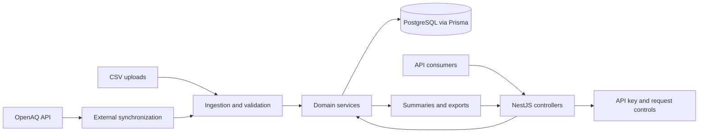

# Architecture

EnviroTrack is a research-oriented environmental data API. It collects observations from file imports and an external data source, stores normalized records, and exposes query and reporting endpoints.

## Data flow

1. Incoming CSV rows or external observations are validated and normalized.
2. The ingestion/synchronization path maps source fields to the application's domain model.
3. Prisma persists station, reading, and synchronization records in PostgreSQL.
4. API endpoints expose station and reading queries, summaries, and exports.
5. Operational metadata supports visibility into synchronization activity.

## Design decisions

- Keep external-source integration separate from the domain model so upstream API changes are isolated.
- Validate and normalize data at ingestion boundaries rather than trusting source payloads.
- Preserve source and synchronization context where possible so results can be interpreted and traced.
- Use API-key protection and rate limiting for privileged write operations.
- Make reporting endpoints read-oriented and keep data transformations explicit.

## Data quality and limitations

Air-quality readings require careful treatment of units, timestamps, station coverage, duplicate observations, and source provenance. This project is a research/data-management tool, not a certified regulatory monitoring network. Comparisons with guideline values are informational and require validation of the measurement context.

## Operational checklist

Monitor sync failures and duration, log rejected records with safe context, validate API-key configuration at startup, test pagination and large exports, and establish backup/retention policies before production deployment.
